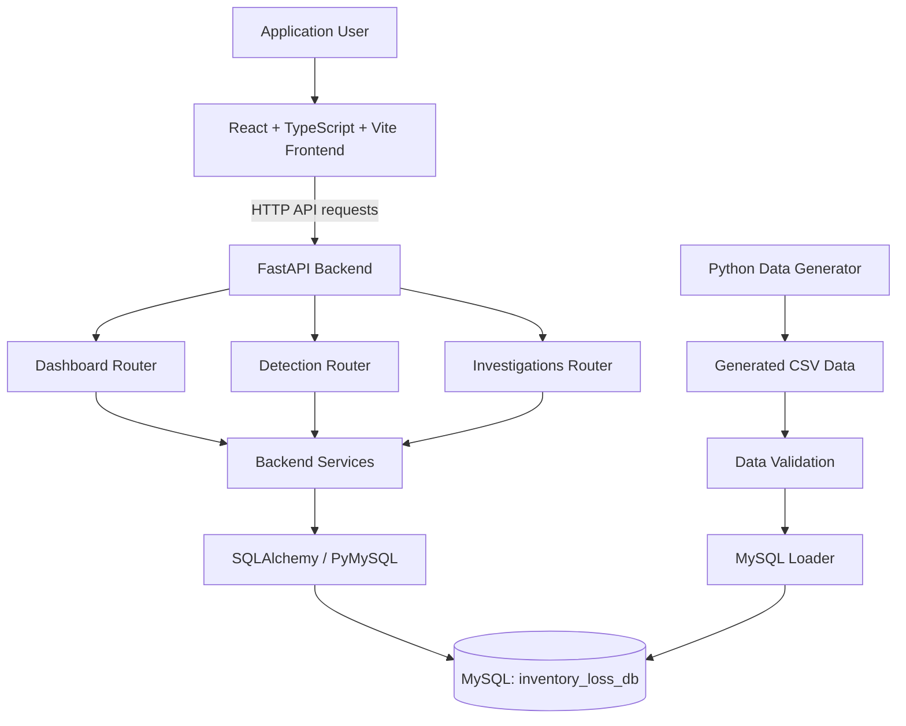

# Smart Inventory Loss Detection & Investigation System

> A database-driven application for detecting unusual inventory
> discrepancies, prioritizing shrinkage alerts and managing
> investigations with supporting evidence and audit history.

**Candidate project submission --- YottaFlex AI Recruitment Drive**

## Table of Contents

-   [1. Project Overview](#1-project-overview)
-   [2. Problem Statement and
    Objectives](#2-problem-statement-and-objectives)
-   [3. Features](#3-features)
-   [4. Technology Stack](#4-technology-stack)
-   [5. System Architecture](#5-system-architecture)
-   [6. Project Structure](#6-project-structure)
-   [7. Data Model and Generation](#7-data-model-and-generation)
-   [8. Detection Logic](#8-detection-logic)
-   [9. Investigation Workflow](#9-investigation-workflow)
-   [10. Installation and Setup](#10-installation-and-setup)
-   [11. Running the Application](#11-running-the-application)
-   [12. API Documentation](#12-api-documentation)
-   [13. Validation and Testing](#13-validation-and-testing)
-   [14. Application Screenshots](#14-application-screenshots)
-   [15. AI-Assisted Development
    Disclosure](#15-ai-assisted-development-disclosure)
-   [16. Design Decisions and
    Trade-offs](#16-design-decisions-and-trade-offs)
-   [17. Known Limitations](#17-known-limitations)
-   [18. Future Improvements](#18-future-improvements)

------------------------------------------------------------------------

## 1. Project Overview

The **Smart Inventory Loss Detection & Investigation System** is a web
application designed to help retail operations identify unusual
inventory discrepancies, generate risk-based alerts and manage follow-up
investigations.

The system uses inventory movements, cycle counts, returns, adjustments
and transfer records to identify conditions that may indicate inventory
loss or process inconsistencies. It provides a central interface for
reviewing alerts, examining available evidence, managing investigations
and tracking investigation activity.

The application uses a React frontend, a Python FastAPI backend and a
MySQL relational database. A separate Python data-generation pipeline
creates reproducible sample data for development and validation.

## 2. Problem Statement and Objectives

Retail businesses process many inventory events across stores and
products. Differences between recorded stock and physically counted
stock can arise from sales, receipts, returns, damage, transfers,
adjustments, data-entry mistakes or unexplained loss.

Finding unusual patterns manually across large numbers of transactions
can be time-consuming. A discrepancy alone also does not establish its
cause.

This project aims to:

-   Reconcile expected inventory against physical cycle counts.
-   Detect selected unusual transaction patterns.
-   Prioritize detected conditions using rule-based risk scores.
-   Retain supporting evidence for alerts.
-   Provide an investigation workflow with assignments, status changes,
    notes and audit history.
-   Present operational information through a database-connected web
    interface.
-   Validate data integrity and detection behaviour using controlled
    test scenarios.

An alert is an indicator for further examination, not proof of theft or
employee misconduct.

## 3. Features

### Dashboard

-   Summary metrics for alerts, stores, SKUs, movements and cycle
    counts.
-   Alert trend visualization.
-   Risk-level distribution.
-   Recent alert records.
-   Investigation status summary.

### Alert Management

-   Display detected shrinkage alerts.
-   Show alert identifiers, store and SKU references, detection rules,
    risk scores and statuses.
-   Review alert details and supporting evidence where exposed by the
    API.
-   Initiate investigations from alerts.

### Investigation Management

-   Create investigations linked to alerts.
-   View investigation records.
-   Assign investigations to employees.
-   Update investigation statuses.
-   Add investigation notes.
-   Review investigation history and recorded activity.

### Analytics

-   Visualize available alert and investigation metrics.
-   Review risk distribution and alert trends.
-   Present analyses based on data exposed by the backend.

### Master Data and Activity

-   Stores.
-   SKUs.
-   Employees and investigation activity.

### Settings and Help

-   User-facing application preferences and supporting information,
    according to the functionality implemented in the frontend.

**Data availability note:** The frontend can only retrieve fields and
records exposed by existing backend APIs. Where a direct directory or
search endpoint is not available, the interface should disclose the
limitation rather than imply that a derived list is a complete
master-data directory.

## 4. Technology Stack

  Layer               Technology
  ------------------- -------------------------
  Frontend            React, TypeScript, Vite
  UI icons            Lucide React
  Charts              Recharts
  Styling             CSS
  Backend             Python, FastAPI
  Database access     SQLAlchemy, PyMySQL
  Database            MySQL
  Data generation     Python, Pandas, NumPy
  API documentation   FastAPI / Swagger UI

Refer to the dependency files for the exact installed package versions.

## 5. System Architecture

The application uses a layered architecture consisting of a frontend,
API backend, relational database and a separate data-generation
pipeline.



### Frontend Layer

The frontend is implemented using React, TypeScript and Vite. It
provides the user interface for dashboard monitoring, alert review,
investigation management, analytics and available master-data views.

Frontend API communication is organized in service modules under
`frontend/src/services/`.

### Backend Layer

The backend is implemented using FastAPI. The router files identified in
the project structure are:

-   `backend/app/routers/dashboard.py`
-   `backend/app/routers/detection.py`
-   `backend/app/routers/investigations.py`

The service modules identified are:

-   `backend/app/services/detection_engine.py`
-   `backend/app/services/anomaly_validator.py`
-   `backend/app/services/investigation_service.py`

Database connectivity is configured in `backend/app/database.py`, and
the application entry point is `backend/app/main.py`.

### Database Layer

MySQL stores the application's relational data. SQLAlchemy and PyMySQL
provide database connectivity. The schema is defined in
`database/schema.sql`.

### Data Generation Pipeline

The data-generation pipeline is separate from the web application. It
generates master and transactional data, injects controlled anomaly
scenarios, validates generated records and loads the baseline dataset
into MySQL.

### Main Data Flow

1.  The user interacts with the React frontend.
2.  The frontend sends a request to an available FastAPI endpoint.
3.  The relevant router invokes the backend service.
4.  The service reads or writes records using the database connection
    layer.
5.  The backend returns a response.
6.  The frontend renders the returned information.

The data-generation pipeline is run separately to create and load test
data.


## 6. Project Structure

This structure is based on the project tree supplied during
documentation preparation. Generated folders such as `node_modules`,
virtual environments, build output and Python cache folders are omitted.

``` text
Inventory_loss_Detection/
├── .env                         # Local secrets; do not commit
├── .gitignore
├── README.md
│
├── backend/
│   └── app/
│       ├── __init__.py
│       ├── main.py
│       ├── database.py
│       ├── routers/
│       │   ├── __init__.py
│       │   ├── dashboard.py
│       │   ├── detection.py
│       │   └── investigations.py
│       └── services/
│           ├── __init__.py
│           ├── anomaly_validator.py
│           ├── detection_engine.py
│           └── investigation_service.py
│
├── data-generator/
│   ├── config/
│   │   ├── db_config.py
│   │   └── settings.py
│   ├── generators/
│   │   ├── anomaly_injector.py
│   │   ├── cycle_count_generator.py
│   │   ├── data_validator.py
│   │   ├── employee_generator.py
│   │   ├── movement_generator.py
│   │   ├── opening_stock_generator.py
│   │   ├── promotion_generator.py
│   │   ├── return_generator.py
│   │   ├── return_movement_integrator.py
│   │   ├── shift_generator.py
│   │   ├── sku_generator.py
│   │   ├── store_generator.py
│   │   └── store_sku_generator.py
│   ├── output/                  # Generated datasets; include if required
│   ├── main.py
│   ├── mysql_loader.py
│   ├── requirements.txt
│   └── test_db_connection.py
│
├── database/
│   └── schema.sql
│
├── docs/
│   ├── business_rules.md
│   └── data_dictionary.md
│
└── frontend/
    ├── public/
    ├── src/
    │   ├── assets/
    │   ├── components/
    │   │   ├── AlertDetailsModal.tsx
    │   │   ├── ApiNotice.tsx
    │   │   ├── BrandLogo.tsx
    │   │   ├── ConfirmDialog.tsx
    │   │   ├── Header.tsx
    │   │   ├── InvestigationDetailsModal.tsx
    │   │   ├── NotificationDrawer.tsx
    │   │   ├── Pagination.tsx
    │   │   ├── Sidebar.tsx
    │   │   └── Toast.tsx
    │   ├── data/
    │   ├── pages/
    │   │   ├── AlertsPage.tsx
    │   │   ├── AnalyticsPage.tsx
    │   │   ├── DashboardPage.tsx
    │   │   ├── EmployeesPage.tsx
    │   │   ├── HelpPage.tsx
    │   │   ├── InvestigationsPage.tsx
    │   │   ├── SettingsPage.tsx
    │   │   ├── SKUsPage.tsx
    │   │   └── StoresPage.tsx
    │   ├── services/
    │   │   ├── apiClient.ts
    │   │   ├── dashboardApi.ts
    │   │   ├── detectionApi.ts
    │   │   ├── investigationApi.ts
    │   │   ├── preferencesStorage.ts
    │   │   ├── systemApi.ts
    │   │   └── testConnection.ts
    │   ├── types/
    │   ├── App.tsx
    │   ├── App.css
    │   ├── index.css
    │   └── main.tsx
    ├── index.html
    ├── package.json
    ├── package-lock.json
    ├── tsconfig.json
    └── vite.config.ts
```

## 7. Data Model and Generation

### Database entities

The project schema includes the following entities identified during
development:

-   Stores
-   SKUs
-   Employees
-   Roles
-   Employee roles
-   Shifts
-   Store-SKU associations
-   Promotions
-   Promotion-SKU associations
-   Inventory movements
-   Cycle counts
-   Returns
-   Shrinkage alerts
-   Alert evidence
-   Investigations
-   Investigation history

Refer to [`database/schema.sql`](database/schema.sql) for the schema and
[`docs/data_dictionary.md`](docs/data_dictionary.md) for field
definitions.

### Data generation

The generator is configured through:

-   `data-generator/config/settings.py`
-   `data-generator/config/db_config.py`

It includes separate modules for stores, SKUs, employees, shifts,
opening stock, inventory movements, cycle counts, promotions and
returns.

The anomaly injector creates controlled test scenarios, and the data
validator checks generated records before loading.

### Reproducibility

The generator configuration uses a fixed random seed (`20261022`) as
recorded during development. A fixed seed helps reproduce generated
datasets when the generator version and configuration remain consistent.

### Development dataset

The following figures were observed during the documented development
run. They describe that run and do not claim that the full target-scale
dataset was loaded.

  Dataset                 Observed records
  --------------------- ------------------
  Stores                                10
  SKUs                                 100
  Employees                             30
  Inventory movements                5,480
  Cycle counts                         500
  Returns                               80
  Transfer groups                      591

The movement total includes opening movements and other generated
movement records. Recheck the database if the dataset is regenerated.

## 8. Detection Logic

The detection engine contains rule-based checks for selected inventory
discrepancies and transaction patterns.

### Expected inventory reconciliation

``` text
Expected Stock =
    Opening Stock
  + Receipts
  + Returns In
  + Transfers In
  - Sales
  - Transfers Out
  - Damage
  - Other Adjustments Out
```

A shortage is identified when expected stock is greater than the
physical counted quantity.

``` text
Shortage Variance = Expected Quantity - Counted Quantity
```

A positive variance indicates a shortage. A negative variance indicates
an overage.

### Shortage detection

The detection service compares expected quantity and counted quantity
recorded for cycle counts. Where expected quantity exceeds counted
quantity, it can create a shrinkage alert and associate supporting count
and movement evidence.

### Repeated adjustment detection

The detection service groups adjustment-out activity by relevant
attributes, including store, SKU, employee-role reference and date.
Groups meeting the configured repeated-adjustment condition can generate
alerts with supporting movement evidence.

### Transfer inconsistency detection

Transfer records are grouped using their transfer-group reference. The
detection logic checks for missing or duplicate legs, quantity
mismatches and inconsistent store relationships.

A valid transfer should have a corresponding outgoing and incoming
movement. The two legs should not be treated as two independent
shrinkage events.

### Risk scoring

The shortage scoring formula recorded in the implemented development
logic is:

``` text
Score = 25 + (0.75 × shortage percentage)
```

The score is capped at 100.

This is an illustrative prioritization score. It is not a calibrated
probability of fraud, theft or employee misconduct.

For exact implementation details, refer to
`backend/app/services/detection_engine.py` and `docs/business_rules.md`.

## 9. Investigation Workflow

The investigation service supports the investigation lifecycle through
the available API operations:

1.  A shrinkage alert is generated.
2.  A user reviews the alert and its available evidence.
3.  An investigation can be created for the alert.
4.  An investigation can be assigned to an employee.
5.  Its status can be updated.
6.  Notes can be added.
7.  Investigation changes are recorded in investigation history.

The statuses used in the application include:

-   `OPEN`
-   `ASSIGNED`
-   `INVESTIGATING`
-   `RESOLVED`
-   `ESCALATED`

The investigation history records status transitions, notes, employee
references where supplied and timestamps.

## 10. Installation and Setup

### Prerequisites

-   Python 3.13 (used in the documented development environment)
-   Node.js and npm
-   MySQL Server
-   Git

MySQL Workbench is recommended for database inspection but is not
required by the application.

### Clone the repository

Replace the placeholder with the actual public repository URL after
publishing:

``` bash
git clone <YOUR_PUBLIC_GITHUB_REPOSITORY_URL>
cd Inventory_loss_Detection
```

### Create the MySQL database

``` sql
CREATE DATABASE inventory_loss_db;
```

Execute `database/schema.sql` using MySQL Workbench or the MySQL
command-line client. Ensure the database user has the permissions
required by the application.

### Configure environment variables

Create a root-level `.env` file using the variable names expected by the
project's database configuration.

Do not commit the real `.env` file or expose database passwords.

Create `.env.example` after confirming the exact variable names in
`data-generator/config/db_config.py` and `backend/app/database.py`.

The following is a placeholder example only. Confirm the actual names
against the source code before using it:

``` dotenv
DB_HOST=localhost
DB_PORT=3306
DB_NAME=inventory_loss_db
DB_USER=your_mysql_username
DB_PASSWORD=your_mysql_password
```

### Set up the data-generator environment

From the project root:

``` powershell
cd data-generator
python -m venv venv
.\venv\Scripts\Activate.ps1
python -m pip install --upgrade pip
pip install -r requirements.txt
python -m pip install cryptography
```

The `cryptography` package is required by the development MySQL
authentication configuration when using authentication methods such as
`caching_sha2_password` or `sha256_password`.

If PowerShell blocks virtual-environment activation, use the Python
executable directly:

``` powershell
.\venv\Scripts\python.exe -m pip install -r requirements.txt
```

### Generate and load data

Review the generator configuration and intended workflow before running
the generator.

From the `data-generator` directory, the main generator entry point is:

``` powershell
python main.py
```

The MySQL loader is:

``` powershell
python mysql_loader.py
```

Run these commands according to the workflow in the current source code.
Confirm the target database is prepared correctly before loading data.
Do not run a loader against a database containing records that must be
preserved.

### Install frontend dependencies

Open a separate terminal:

``` powershell
cd frontend
npm install
```

## 11. Running the Application

### Start the backend

From the project root, activate the Python environment used by the
backend. In the documented development setup, the virtual environment
was located under `data-generator/venv`.

``` powershell
.\data-generator\venv\Scripts\Activate.ps1
cd backend
python -m uvicorn app.main:app --reload
```

Backend base URL:

``` text
http://127.0.0.1:8000
```

Health endpoint:

``` text
http://127.0.0.1:8000/health
```

### Start the frontend

In another terminal:

``` powershell
cd frontend
npm run dev
```

Open the local URL printed by Vite. The development environment used:

``` text
http://localhost:5173
```

## 12. API Documentation

The backend router modules identified in the project structure are:

  Router file           Responsibility
  --------------------- -----------------------------------------------
  `dashboard.py`        Dashboard summary and visualization data
  `detection.py`        Detection execution and anomaly validation
  `investigations.py`   Investigation creation, retrieval and updates

The exact endpoint paths, methods, request schemas and response
structures should be taken from the source code or the running Swagger
documentation at `/docs`.

Do not infer an endpoint from a frontend page name. A frontend page does
not necessarily imply that a corresponding direct backend endpoint
exists.

## 13. Validation and Testing

### Data validation

The data-generation project includes:

-   `generators/data_validator.py`
-   `generators/anomaly_injector.py`
-   Backend `anomaly_validator.py`

During the recorded development run, the data validator reported 29
checks passing.

### Database checks

The development workflow included checks for:

-   Primary-key and foreign-key integrity.
-   Transfer pairing and quantity consistency.
-   Missing adjustment reasons.
-   Inventory reconciliation.
-   Timestamp consistency.
-   Duplicate records.
-   Controlled anomaly scenarios.

### Detection checks

Observed results from the documented development dataset included:

  Detection check                                       Observed result
  --------------------------------------------------- -----------------
  Shortage alerts created                                           105
  Repeated-adjustment groups detected                                22
  Transfer inconsistencies in valid baseline groups                   0

These are development-run observations, not universal expected results
for every generated dataset or configuration.

### Manual application verification

The application was manually exercised during development, including:

-   Backend health and database connectivity.
-   Dashboard API responses.
-   Alert display.
-   Risk distribution and alert trend.
-   Investigation status display.
-   Investigation creation and history.
-   Employee investigation activity.

Repeat relevant checks against the final committed version and record
any failures or limitations honestly.

## 14. Application Screenshots

Capture screenshots from the final running application and add the image
files to the repository.

Recommended folder:

``` text
docs/
└── screenshots/
    ├── dashboard.png
    ├── alerts.png
    ├── investigations.png
    ├── analytics.png
    ├── stores.png
    ├── skus.png
    ├── employees.png
    └── settings.png
```

After adding the actual images, the following references will display
them on GitHub.

### Dashboard


### Alerts


### Investigations


### Analytics


### Stores


### SKUs


### Employees


### Settings


## 15. AI-Assisted Development Disclosure

AI tools were used as development assistants during parts of this
project. Their use should be disclosed transparently in accordance with
the candidate project submission guidelines.

AI assistance included areas such as:

-   Discussing project structure and implementation approaches.
-   Explaining technical concepts and debugging errors.
-   Supporting API integration and frontend development.
-   Reviewing UI/UX improvements.
-   Helping organize project documentation.

Complete the table below with the tools and tasks actually used:

  -----------------------------------------------------------------------
  AI tool                             Actual use in this project
  ----------------------------------- -----------------------------------
  ChatGPT                             Specify the planning, debugging,
                                      coding guidance and documentation
                                      tasks performed

  Antigravity                         Specify the code generation,
                                      editing and UI implementation tasks
                                      performed

  Other tools                         Add only if actually used
  -----------------------------------------------------------------------

### Personal review and validation

Describe what you personally:

-   Implemented or modified.
-   Reviewed in generated code.
-   Tested against the running backend and database.
-   Corrected after encountering errors.
-   Validated through SQL queries, API responses or UI testing.

Do not claim that AI-generated code was independently implemented if it
was not. Be specific about where AI assistance was substantial and what
you personally understood, reviewed and validated.

## 16. Design Decisions and Trade-offs

### Layered architecture

The frontend, API backend, database and data-generation pipeline are
separated to keep presentation, business logic, persistence and
test-data preparation organized.

### Relational database

MySQL represents relationships among stores, SKUs, employees, movements,
alerts and investigations.

### Rule-based detection

Explicit detection rules make the initial implementation understandable
and easier to validate against controlled scenarios. They are not
intended to establish intent or prove wrongdoing.

### Evidence and audit history

Alerts retain supporting evidence, while investigation history provides
traceability of case activity and status changes.

### Reproducible data generation

A fixed random seed supports repeatable development and validation runs,
provided the generator version and configuration remain consistent.

### Performance and data volume

Large datasets should be accessed using appropriate filtering and
pagination where supported. Loading every transaction into the browser
at once would be inefficient.

## 17. Known Limitations

-   The development dataset is smaller than the full target-scale
    dataset.
-   Some master-data views may be limited by the endpoints exposed by
    the current backend.
-   Search, filtering and pagination coverage depends on the
    capabilities of the existing API.
-   The implemented risk scoring is rule-based and illustrative; it has
    not been established as a statistically calibrated fraud
    probability.
-   Generated test data cannot fully represent the complexity of real
    retail operations.
-   The system supports investigation workflows but does not
    independently determine the cause of a shortage.
-   Production deployment, authentication hardening, authorization
    review, monitoring and large-scale performance testing require
    additional work before operational use.

Update this section if final verification identifies additional
limitations or resolves any of the items above.

## 18. Future Improvements

Potential future improvements include:

-   Testing with larger datasets and more stores.
-   More comprehensive database-backed search and pagination.
-   Further role-based access control.
-   Additional reporting and export options.
-   Calibration of risk scores using reviewed outcomes.
-   More advanced anomaly detection methods.
-   Production deployment, monitoring and security hardening.

------------------------------------------------------------------------

## Project Submission

**Project:** Smart Inventory Loss Detection & Investigation System\
**Submission:** YottaFlex AI Recruitment Drive --- Candidate Project

The purpose of this project is to demonstrate an end-to-end approach to
inventory loss monitoring, anomaly detection, evidence-based
investigation and transparent engineering decision-making.
